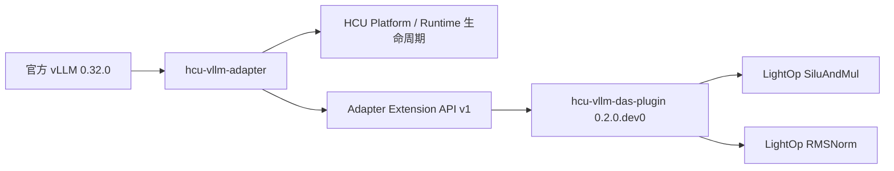

# hcu-vllm-adapter + vLLM 0.32 跨机器迁移与适配手册

更新时间：2026-10-26
适用对象：在另一台 HCU 服务器部署、复现或继续开发 vLLM 0.32 Adapter 与 DAS 优化插件的工程人员。

## 1. 文档目标

本手册提供两条路径：

1. **同 ABI 机器直接部署（推荐）**：复制已经验证的三个 wheel，在目标机完成安装、安装态证明、HCU 算子验证和模型 A/B。
2. **不同软件栈重新适配**：从固定源码提交重新构建，并把目标机视为新的候选平台，重新执行全部验证，不能继承本机结论。

当前生产候选采用三层结构：



- vLLM 保持官方 `v0.32.0` 代码边界。
- Adapter 独占 `vllm.platform_plugins` 和 `vllm.general_plugins`。
- DAS Plugin 只通过 `hcu_vllm_adapter.extensions` 加载优化，不接管平台。
- Plugin 可整体卸载，也可通过环境变量逐项回滚。

## 2. 已验证范围与非目标

### 2.1 已验证范围

`hcu-vllm-das-plugin==0.2.0.dev0` 当前包含：

- LightOp `SiluAndMul`；
- LightOp 普通 `RMSNorm`；
- LightOp fused-add `RMSNorm`；
- 不满足优化条件时自动回退 vLLM 0.32 原生实现；
- master 开关和算子级开关；
- 安装包所有权、入口点和 OOT 注册验收。

已在 `gfx938` 上完成 BF16/FP16 算子数值验证。便携测试门禁为：

```text
59 passed, 2 skipped
```

两个 skip 是需要显式启用的 HCU 实机测试；它们已分别在最终 wheel 上执行并各自得到 `1 passed`。

### 2.2 当前不能继承的结论

以下内容尚未形成生产支持声明：

- `gfx92a` 优化算子；
- Qwen3-8B Plugin enabled/disabled 模型 A/B；
- Gemma RMSNorm、Qwen gated RMSNorm；
- Attention、MoE、量化、采样、Mamba、模型专用实现；
- TP/DP/EP/PP、长稳、并发和性能收益。

原 Adapter 已有 Qwen3-8B、HumanEval 等基线证据，但它们是 **Adapter baseline**，不能自动算作 Plugin enabled 证据。

## 3. 固定源码与制品

### 3.1 源码版本

| 项目 | 仓库/标签 | 分支或提交 |
| --- | --- | --- |
| 官方 vLLM | `https://github.com/vllm-project/vllm.git` | tag `v0.32.0`，commit `5df63a7203cdb9328d824a27b682e77c7b9928be` |
| Adapter | `https://github.com/alexanderbin123/hcu-vllm-adapter.git` | branch `feat/das-v0281-plugin-intake`，commit `45525d0056e788fd189172d53756c4b53a151e8a` |
| DAS Plugin | `https://github.com/alexanderbin123/vllm-plugin-das.git` | branch `feat/vllm032-rmsnorm-extension` |
| Plugin 运行时代码 | 同上 | commit `1be8d694edff552eebe8b3b9a9c3b2e44235d486` |
| Plugin 覆盖清单 | 同上 | commit `5bc05eac5e0fc6e6250865485b703fdf0ef8972f` |
| DAS 参考基线 | `HYGON-AI/vllm-plugin-das` | branch `v0.28.1-dev`，commit `cd412a0d53b9b517fbc3dcdf96121dc3daa1096c` |

其中 `1be8d694...` 是已验证 wheel 的精确运行时代码基线；远端分支头还包含后续补充的覆盖清单和本文档。需要复现 wheel 时固定到运行时代码提交，需要获取最新文档时使用分支头。

> Plugin 仓库根目录仍是 vLLM 0.28.1 开发参考。面向 vLLM 0.32 构建时，只构建 `adapter_extension/`。

### 3.2 已验证 wheel

源机器目录：

```text
/models/artifacts/vllm032-das-rmsnorm-RejxtR/wheels-final/
```

需要复制到目标机的三个文件：

| 文件 | 大小 | SHA256 |
| --- | ---: | --- |
| `vllm-0.32.0+rocm723-cp312-cp312-linux_x86_64.whl` | 35,760,881 bytes | `da7bda7ce51871b064f957076cfae43b40fee7226711432e88dcf2a5c0c91640` |
| `hcu_vllm_adapter-0.1.0.dev0-py3-none-any.whl` | 16,848 bytes | `0c9e3512dccbe5a4018218c710fb46608b4b6776cb5ef21b52d7f73e0cdfcd5d` |
| `hcu_vllm_das_plugin-0.2.0.dev0-py3-none-any.whl` | 12,741 bytes | `5510cc193997579455b61d6d6e841bbfa6d91ff2df281678dd8fa820d3315dc7` |

同时建议复制 Plugin 和 Adapter 两个源码仓库。安装态校验工具和 HCU 实机测试属于源码侧运维工具，不包含在运行时 wheel 中。

## 4. 运行时 ABI 基线

最终候选实际使用的版本：

| 组件 | 版本 |
| --- | --- |
| Python | `3.12.12` |
| Torch | `2.11.0+das.opt1.dtk2610.2609201632.gf74cd7` |
| Torch HIP | `7.2.26365` |
| LightOp | `0.6.0+dtk2610.torch2110.2610222215.gdf8246` |
| vLLM | `0.32.0+rocm723` |
| Adapter | `0.1.0.dev0` |
| DAS Plugin | `0.2.0.dev0` |

`vLLM` wheel 是 `cp312`，所以直接复用该 wheel 时，目标机必须使用兼容的 Python 3.12 x86_64 环境。

Adapter 和 Plugin 虽然是纯 Python wheel，但其运行结果依赖 Torch、DTK/HIP、LightOp 和 vLLM ABI。版本不一致时，即使 pip 安装成功，也不能视为兼容。

## 5. 目标机部署前检查

### 5.1 硬件和驱动

```bash
rocminfo | grep -E 'gfx938|gfx92a'
rocm-smi --showmeminfo vram --showuse --json
grep -l '^0x1d94$' /sys/bus/pci/devices/*/vendor
```

要求：

- Linux sysfs 能看到 Hygon PCI vendor `0x1d94`；
- HCU 驱动、DTK/HIP、Torch 和 LightOp 可以正常加载；
- 实机测试前所选卡没有其他任务，显存占用处于空闲基线；
- 不得通过杀掉未知进程来制造“空闲”环境。

Adapter 采用 fail-closed 探测。容器看不到 `/sys/bus/pci/devices` 时，即使宿主机有 HCU，也可能不选择 HCU Platform。

### 5.2 Python 和关键包

```bash
python3.12 --version
python3.12 - <<'PY'
from importlib import metadata
import torch

for name in ("torch", "lightop", "packaging"):
    print(name, metadata.version(name))
print("torch HIP", torch.version.hip)
print("HCU available", torch.cuda.is_available())
PY
```

如果这里不能导入 Torch 或 LightOp，不要继续安装 vLLM 候选。

### 5.3 凭据安全

- 不要把 GitHub access token 写入本文档、shell 历史、Git remote URL 或构建日志。
- 使用 SSH key、Git credential helper 或目标机已有的受控凭据。
- 运行时部署不需要 GitHub token；可以只复制固定 wheel 和源码归档。

## 6. 路线 A：同 ABI 目标机直接安装

以下命令假设 wheel 已放到目标机的一个可写目录。变量名可以调整，但不要复用系统的 `HOME` 等通用变量。

```bash
export HCU_DEPLOY_ROOT=/opt/hcu-vllm032
export HCU_WHEEL_DIR="$HCU_DEPLOY_ROOT/wheels"
export HCU_VENV="$HCU_DEPLOY_ROOT/venv"

python3.12 -m venv --system-site-packages "$HCU_VENV"
```

使用 `--system-site-packages` 的前提是目标机系统 Python 已安装 ABI 匹配的 HCU Torch 和 LightOp。若它们位于另一个受控虚拟环境，应在那个环境内安装三个 wheel，不要混用两套 Torch。

### 6.1 核对 wheel

```bash
sha256sum "$HCU_WHEEL_DIR"/*.whl
```

输出必须与第 3.2 节三个 SHA256 完全一致。wheel 哈希不匹配时停止安装。

### 6.2 按固定顺序安装

```bash
"$HCU_VENV/bin/python" -E -m pip install --no-deps \
  "$HCU_WHEEL_DIR/vllm-0.32.0+rocm723-cp312-cp312-linux_x86_64.whl"

"$HCU_VENV/bin/python" -E -m pip install --no-deps \
  "$HCU_WHEEL_DIR/hcu_vllm_adapter-0.1.0.dev0-py3-none-any.whl"

"$HCU_VENV/bin/python" -E -m pip install --no-deps \
  "$HCU_WHEEL_DIR/hcu_vllm_das_plugin-0.2.0.dev0-py3-none-any.whl"
```

必须使用 `--no-deps`，避免 pip 从公网替换准备好的 HCU Torch、vLLM 或其他 ABI 组件。

### 6.3 核对安装版本和模块来源

```bash
"$HCU_VENV/bin/python" -E - <<'PY'
from importlib import metadata
import json
import torch
import vllm

names = (
    "torch",
    "lightop",
    "vllm",
    "hcu-vllm-adapter",
    "hcu-vllm-das-plugin",
)
print(json.dumps({name: metadata.version(name) for name in names}, indent=2))
print("vLLM origin:", vllm.__file__)
print("Torch HIP:", torch.version.hip)
PY
```

若宿主 shell 设置了 `PYTHONPATH`，必须清除它或始终通过 `python -E` 执行候选环境。否则旧系统 vLLM 可能排在虚拟环境 wheel 前面。

## 7. 安装态验收

假设 Plugin 源码位于：

```bash
export HCU_PLUGIN_SRC=/opt/src/vllm-plugin-das
```

执行：

```bash
VLLM_PLUGINS=hcu_adapter \
HSA_VISIBLE_DEVICES=0 \
HIP_VISIBLE_DEVICES=0 \
"$HCU_VENV/bin/python" -E \
  "$HCU_PLUGIN_SRC/adapter_extension/tools/verify_installed.py"
```

成功输出必须满足：

- `schema_version` 为 `2`；
- vLLM 版本属于 `0.32.0` release line；
- Adapter 和 Plugin 都是非 editable wheel 安装；
- DAS extension 状态为 `active`；
- capability 同时包含：
  - `lightop-rms-norm`
  - `lightop-silu-and-mul`
- OOT owner 精确为：
  - `hcu_vllm_das.rms_norm.HcuRMSNorm`
  - `hcu_vllm_das.silu_and_mul.HcuSiluAndMul`

安装后 `RECORD` 内容哈希可能因安装路径和 `direct_url.json` 不同而变化。跨机器身份以 **wheel SHA256** 为准；目标机 verifier 输出的 RECORD 哈希应单独归档，不能强行要求与源机器相同。

## 8. 便携测试与官方 vLLM 0.32 契约

准备官方源码：

```bash
export HCU_VLLM_SRC=/opt/src/vllm-0.32.0
git clone https://github.com/vllm-project/vllm.git "$HCU_VLLM_SRC"
git -C "$HCU_VLLM_SRC" checkout v0.32.0
git -C "$HCU_VLLM_SRC" rev-parse HEAD
```

最后一条必须输出：

```text
5df63a7203cdb9328d824a27b682e77c7b9928be
```

执行 Plugin 便携测试：

```bash
cd "$HCU_PLUGIN_SRC"
VLLM_TARGET_ROOT="$HCU_VLLM_SRC" \
"$HCU_VENV/bin/python" -E -m pytest tests/vllm032 -q
```

在没有显式开启 HCU live 测试时，当前期望结果为：

```text
59 passed, 2 skipped
```

如果测试数量或契约断言发生变化，先检查源码提交是否一致，不要直接更新期望值掩盖差异。

## 9. gfx938 实机算子验证

仅在卡确实空闲时执行。先检查：

```bash
rocm-smi --showmeminfo vram --showuse --json
```

### 9.1 RMSNorm

```bash
cd "$HCU_PLUGIN_SRC"
HCU_VLLM032_RMSNORM_LIVE=1 \
VLLM_PLUGINS=hcu_adapter \
HSA_VISIBLE_DEVICES=0 \
HIP_VISIBLE_DEVICES=0 \
"$HCU_VENV/bin/python" -E -m pytest \
  tests/vllm032/test_rms_norm_hcu.py -q -rs
```

期望：`1 passed`。该测试覆盖 BF16/FP16、普通和 fused-add RMSNorm、master/child 回滚以及窄宽度、无权重和 variance override 回退。

### 9.2 SiluAndMul

```bash
cd "$HCU_PLUGIN_SRC"
HCU_VLLM032_LIVE=1 \
VLLM_PLUGINS=hcu_adapter \
HSA_VISIBLE_DEVICES=0 \
HIP_VISIBLE_DEVICES=0 \
"$HCU_VENV/bin/python" -E -m pytest \
  tests/vllm032/test_silu_and_mul_hcu.py -q -rs
```

期望：`1 passed`。

HCU 测试出现 skip 不算通过。若设备不是 `gfx938`，测试应停止而不是修改架构断言。

## 10. gfx938 与 gfx92a 部署策略

### 10.1 gfx938

生产前显式设置开关，避免依赖隐式默认值：

```bash
export VLLM_PLUGINS=hcu_adapter
export VLLM_HCU_USE_CUSTOM_OPS=1
export VLLM_HCU_USE_CUSTOM_SILU_AND_MUL=1
export VLLM_HCU_USE_CUSTOM_RMS_NORM=1
```

只有完成第 7、8、9 节以及模型 A/B 后，才建议进入小流量试运行。

### 10.2 gfx92a

当前严格生产策略是关闭整个优化层：

```bash
export VLLM_PLUGINS=hcu_adapter
export VLLM_HCU_USE_CUSTOM_OPS=0
```

这样保留 Adapter 平台能力，但 SiluAndMul 和 RMSNorm 均走 vLLM 原生路径。不能把 gfx938 的数值证据直接用于 gfx92a。

如果后续要验证 gfx92a，应新建独立证据记录，至少执行：

- 安装态验收；
- 两个算子数值测试的 gfx92a 版本；
- Plugin disabled/enabled 模型 A/B；
- 长稳和性能测试；
- 单算子回滚与 master 回滚。

## 11. RMSNorm 优化资格与回退

只有同时满足以下条件，RMSNorm 才进入 LightOp：

- master 和 RMSNorm 子开关开启；
- `VLLM_BATCH_INVARIANT` 为 false；
- 使用真实 weight；
- 没有 variance-size override；
- dtype 是 BF16 或 FP16；
- 输入宽度等于 layer hidden size 且至少为 64；
- input、weight 和 residual（若存在）连续；
- input、weight 和 residual dtype 一致；
- residual 与 input shape 一致。

其他情况自动调用 vLLM 0.32 原生实现。不要为了提高命中率删除这些保护条件。

## 12. 模型级 enabled/disabled A/B

首个模型建议使用本地 BF16 `/models/Qwen3-8B` 或目标机上的同摘要副本。

两次运行必须保持以下条件完全一致：

- 同一个 vLLM、Adapter、Plugin wheel；
- 同一模型文件及摘要；
- 同一张空闲 `gfx938`；
- 相同 prompt、seed、max tokens、max model len；
- eager 模式和相同 attention backend；
- 每次独立进程，前一次退出且显存回落后再启动下一次。

控制组：

```bash
export VLLM_HCU_USE_CUSTOM_OPS=0
```

优化组：

```bash
export VLLM_HCU_USE_CUSTOM_OPS=1
export VLLM_HCU_USE_CUSTOM_SILU_AND_MUL=1
export VLLM_HCU_USE_CUSTOM_RMS_NORM=1
```

推荐复用 Adapter 源码中的隔离探针：

```text
tools/candidate/probe_model_smoke.py
```

固定参数：

```text
--model /models/Qwen3-8B
--prompt "Return only the integer immediately after 41."
--request-id smoke-arithmetic
--max-tokens 32
--seed 0
--max-model-len 512
--gpu-memory-utilization 0.30
```

A/B 通过标准：

- 两个进程均退出 0；
- 平台均为 `hcu_vllm_adapter.platform.hcu`；
- response text、token IDs、finish reason 完全相同；
- 日志没有 fatal、abort、segfault、EngineDead 等诊断；
- 每次结束后显存回到运行前允许范围；
- 优化组的安装态 attestation 已证明两个 OOT owner 生效。

单请求耗时只能作为诊断信息，不能形成性能收益结论。性能结论需要 warm-up、多轮、并发、固定输入集和统计分位数。

## 13. 启动服务

完成前述门禁后，可在受控环境启动。例如：

```bash
env -u PYTHONPATH \
VLLM_PLUGINS=hcu_adapter \
VLLM_HCU_USE_CUSTOM_OPS=1 \
VLLM_HCU_USE_CUSTOM_SILU_AND_MUL=1 \
VLLM_HCU_USE_CUSTOM_RMS_NORM=1 \
HIP_VISIBLE_DEVICES=0 \
"$HCU_VENV/bin/python" -E -m vllm.entrypoints.cli.main \
  serve /models/Qwen3-8B \
  --dtype bfloat16 \
  --enforce-eager \
  --max-model-len 4096
```

实际生产参数应以目标模型、显存容量和已经通过的 topology 验证为准。上述命令不是吞吐调优模板。

## 14. 回滚顺序

### 14.1 单算子回滚

```bash
export VLLM_HCU_USE_CUSTOM_RMS_NORM=0
# 或
export VLLM_HCU_USE_CUSTOM_SILU_AND_MUL=0
```

### 14.2 全部优化回滚

```bash
export VLLM_HCU_USE_CUSTOM_OPS=0
```

### 14.3 卸载 Plugin

```bash
"$HCU_VENV/bin/python" -E -m pip uninstall -y hcu-vllm-das-plugin
```

Adapter 和 vLLM 仍保留。卸载后重新启动服务进程，不能期望运行中的进程动态撤销 OOT 注册。

### 14.4 完整回退

保留旧虚拟环境或容器镜像，以切换环境的方式回退。不要在生产目录中覆盖安装未知 wheel，也不要使用 `pip install -U` 自动解析依赖。

## 15. 路线 B：目标机软件栈不一致时重新构建

出现以下任一情况时，不应直接复用 vLLM wheel：

- Python 不是兼容的 CPython 3.12 ABI；
- Torch/DTK/HIP 版本不同；
- LightOp 是另一构建或缺少所需符号；
- 架构不是已经验证的 `gfx938`；
- 操作系统、glibc、编译器或原生库 ABI 明显不同。

### 15.1 固定源码

```bash
export HCU_SRC_ROOT=/opt/src/hcu-vllm032
export HCU_ADAPTER_SRC="$HCU_SRC_ROOT/hcu-vllm-adapter"
export HCU_PLUGIN_SRC="$HCU_SRC_ROOT/vllm-plugin-das"
export HCU_VLLM_SRC="$HCU_SRC_ROOT/vllm"

git clone https://github.com/vllm-project/vllm.git "$HCU_VLLM_SRC"
git -C "$HCU_VLLM_SRC" checkout 5df63a7203cdb9328d824a27b682e77c7b9928be

git clone --branch feat/das-v0281-plugin-intake \
  https://github.com/alexanderbin123/hcu-vllm-adapter.git \
  "$HCU_ADAPTER_SRC"
git -C "$HCU_ADAPTER_SRC" checkout 45525d0056e788fd189172d53756c4b53a151e8a

git clone --branch feat/vllm032-rmsnorm-extension \
  https://github.com/alexanderbin123/vllm-plugin-das.git \
  "$HCU_PLUGIN_SRC"
git -C "$HCU_PLUGIN_SRC" checkout 1be8d694edff552eebe8b3b9a9c3b2e44235d486
```

### 15.2 构建 Adapter 与 Plugin

```bash
export HCU_BUILD_WHEELS=/opt/build/hcu-vllm032-wheels
mkdir -p "$HCU_BUILD_WHEELS"

python3.12 -m pip wheel --no-deps --no-build-isolation \
  --wheel-dir "$HCU_BUILD_WHEELS" "$HCU_ADAPTER_SRC"

python3.12 -m pip wheel --no-deps --no-build-isolation \
  --wheel-dir "$HCU_BUILD_WHEELS" "$HCU_PLUGIN_SRC/adapter_extension"
```

Plugin 构建产物应是 `hcu_vllm_das_plugin-0.2.0.dev0-py3-none-any.whl`。

### 15.3 vLLM wheel

当前 HCU vLLM wheel 含原生二进制，不能仅凭 `pip wheel` 的成功输出判断 ABI 正确。应使用目标机审核过的 HCU 编译工具链和 Adapter 仓库的候选构建/绑定流程，生成新的 build attestation。

重新构建后必须重新记录：

- vLLM 源码 commit；
- Torch、DTK/HIP、LightOp、编译器版本；
- wheel SHA256；
- 原生模块导入结果；
- 安装态 RECORD 和模块来源；
- HCU 架构及设备测试；
- 模型、稳定性、拓扑和性能结果。

目标机新构建的 wheel 哈希与第 3.2 节不同是正常现象，但它代表一个新的候选，不能继续引用本机验证记录。

## 16. 继续开发新优化时的边界

面向 vLLM 0.32 新增能力时，保持以下原则：

1. Adapter 继续独占平台和 general plugin 入口点。
2. 优化只通过 `hcu_vllm_adapter.extensions` 暴露。
3. 激活前完整 preflight；依赖或 vLLM 契约不满足时 fail closed。
4. 每个算子必须有 master 开关、子开关和 vLLM 原生回退。
5. 热路径不进行架构探测、文件读取或动态安装。
6. 只对已经验证的 dtype、shape、layout 和架构启用优化。
7. 先写失败测试，再写实现；完成 portable、安装态、实机、模型 A/B 后才默认开启。
8. checkpoint-specific、量化、MoE、Attention、采样等能力独立分支、独立版本、独立证据。

当前主要代码位置：

```text
adapter_extension/src/hcu_vllm_das/extension.py
adapter_extension/src/hcu_vllm_das/environment.py
adapter_extension/src/hcu_vllm_das/silu_and_mul.py
adapter_extension/src/hcu_vllm_das/rms_norm.py
adapter_extension/tools/verify_installed.py
tests/vllm032/
```

旧 DAS 模块不能整目录复制。必须逐项比较 vLLM 0.32 的类签名、OOT 注册、fallback 语义、变异参数和 fake implementation。

## 17. 常见故障

| 现象 | 常见原因 | 处理 |
| --- | --- | --- |
| 导入到系统 vLLM 0.28 | 宿主 `PYTHONPATH` 抢先 | 使用 `python -E` 或 `env -u PYTHONPATH` |
| Adapter 没有选择 HCU | `VLLM_PLUGINS` 未包含 `hcu_adapter`，或容器看不到 Hygon PCI sysfs | 修正 allowlist 和设备/sysfs 映射 |
| Extension 状态 failed | LightOp 模块/符号缺失，版本错误，或 vLLM OOT API 不匹配 | 检查 LightOp ABI；不得忽略 verifier 失败 |
| `undefined symbol`/加载原生库失败 | Torch、DTK/HIP、LightOp、vLLM wheel ABI 不一致 | 使用同一审核构建链重新构建 |
| 重复 OOT/custom-op 注册 | 在同一进程绕过 Adapter 手工重复导入模块 | 只通过 Adapter extension 激活一次，重启受污染进程 |
| RMSNorm 未走 LightOp | 输入不满足 dtype/shape/layout/weight 条件，或开关关闭 | 这是预期回退；先核对资格条件，不要删除保护 |
| HCU live 测试被 skip | 未设置 live 环境变量或架构不匹配 | skip 不能算通过；在正确空闲设备上显式执行 |
| verifier 拒绝 editable 安装 | 使用了 `pip install -e` | 构建并安装普通 wheel |
| gfx92a 上行为未知 | 当前没有 gfx92a 实机证据 | master 关闭优化并单独开展验证 |
| 模型输出一致但性能无提升 | 单请求 eager smoke 不是性能测试 | 执行固定 workload、warm-up、并发和统计测试 |

## 18. 目标机证据归档建议

每台机器建立独立证据目录，至少保存：

```text
wheel-sha256.txt
runtime-versions.json
installed-attestation.json
portable-tests.log
rmsnorm-live.log
silu-live.log
device-preflight-before.json
device-preflight-after.json
model-native-control.log
model-plugin-enabled.log
model-ab-comparison.json
```

记录机器标识、HCU 架构、驱动/DTK、Torch、LightOp、Python、vLLM、Adapter、Plugin 和模型摘要。不得把 token、私钥或其他凭据写入证据目录。

## 19. 上线前检查表

- [ ] 三个 wheel SHA256 已核对；
- [ ] Python/Torch/DTK/HIP/LightOp ABI 已核对；
- [ ] Hygon PCI sysfs 对容器可见；
- [ ] `VLLM_PLUGINS=hcu_adapter`；
- [ ] 安装态 verifier 退出 0；
- [ ] portable suite 通过；
- [ ] 目标架构实机算子测试通过且不是 skip；
- [ ] Plugin disabled/enabled 模型 A/B 完全一致；
- [ ] 服务健康、模型接口和业务样例通过；
- [ ] fatal 日志扫描通过；
- [ ] 进程退出和显存回收通过；
- [ ] master 和两个子开关回滚验证通过；
- [ ] `gfx92a` 未验证时 master 保持关闭；
- [ ] 旧环境或镜像可立即回退；
- [ ] 所有证据均不含凭据。

## 20. 相关文档

- `adapter_extension/README.md`
- `docs/validation/v032-adapter-extension-silu.md`
- `docs/validation/v032-adapter-extension-rmsnorm.md`
- `docs/validation/v032-adapter-extension-coverage.md`
- Adapter 仓库：`docs/compatibility.md`
- Adapter 仓库：`docs/upgrades/v0.32.0/acceptance-matrix.md`
- Adapter 仓库：`validation/v0.32.0/model-matrix.json`

本手册的结论边界以具体 wheel SHA256、源码 commit 和目标机新生成的验证证据为准。
